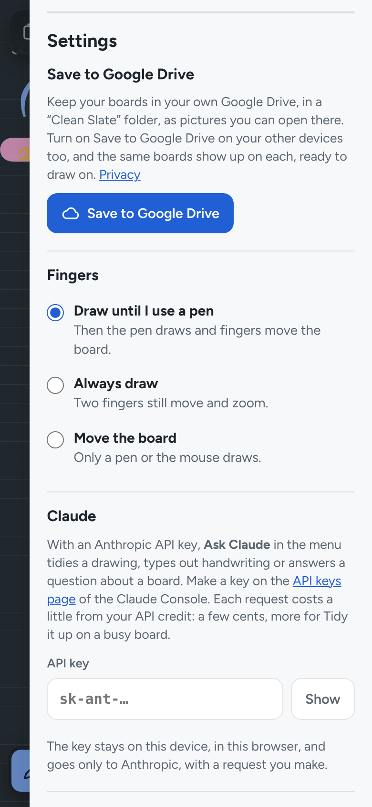

# Clean Slate

**Use it: [clean-slate.junkdrawer.works](https://clean-slate.junkdrawer.works/)**

**A whiteboard for your tablet and pen, in the browser.** Lines get thicker the harder you press. Your palm is
ignored, and two fingers move and zoom the board. Keep as many boards as you like on the device, save any of them
as a picture, or turn on Google Drive and they go into a folder in your own Drive, where you can open them on another
device too. There's no account, no ads and no server.

<p align="center">
  
</p>

<p align="center">
  
  &nbsp;
  
  &nbsp;
  
</p>

## How it works

- **Draw with a pen.** An Apple Pencil, an S Pen, a Surface or Wacom pen: pressure makes the line thicker, and in
  Chrome and Edge the line under the pen can go straight to the screen, with predicted points, to keep the ink
  close behind the tip. A finger or a mouse draws too, a little thicker where it moves slowly.
- **Your palm is left alone.** Until a pen has been used, a finger draws. Once one has, the pen draws and a finger
  moves the board. While the pen is down or hovering close, and for a moment after, every touch is taken for a
  resting hand and ignored, and so is any touch much bigger than a fingertip, or one that spreads out that big. A
  touch that moved the board just before the pen came close was the hand too, and the board goes back. Under
  **Fingers** in the menu you can also have fingers always draw, or never (a computer with no touch screen leaves it
  out).
- **Two fingers move and zoom.** Pinch to zoom from 10% to 1000%; the percentage shows in the corner, and tapping it
  goes back to 100%. For two seconds after, it says **Show it all**: tap it again and the whole drawing fits on
  screen, as Show it all in the menu does. A quick tap with two fingers is Undo, with three, Redo, and a word at the
  bottom says which (or that there was nothing to undo). With a trackpad, scroll to move and pinch to zoom; with a
  mouse, the wheel moves it, Ctrl + wheel zooms, and Space + drag or the right button moves it. While the board moves,
  the drawing moves with it as a picture, so a full board stays quick; what comes into view at the edges is drawn as
  soon as it stops.
- **Pen, highlighter, shapes and eraser.** Six ink colours and three sizes, and five highlighter colours that
  multiply into the board so the writing underneath stays black (on the Slate they lighten it instead, so chalk
  writing stays white and the colour stays bright). Each tool remembers its own colour and size. Undo
  and Redo go back up to 300 steps on each board, Clear included, and the last 50 are kept with the board on the
  device, so they still work after a reload. Clear's message has an **Undo** of its own for a few seconds.
- **Draw a shape and hold still.** Draw a rough line, box, triangle or circle and keep the pen still at the end for
  half a second: it snaps to a clean one, in the same colour and thickness (a phone that can buzzes once). Keep moving
  and it lets go, so a pause mid-drawing does no harm. A nearly level line is made level, and a nearly round loop
  round. The **shapes tool** drags out exact rectangles, ellipses, lines, arrows and double arrows (a head at each
  end, for a measurement), outlined or filled, in the pen's colour and size. A box or an ellipse dragged out nearly
  square comes out square or round; with a mouse, Shift makes it so.
- **The eraser rubs out** just where it touches, like a real one: rub the eyes out of a filled-in circle and the
  board shows through. **Whole lines**, beside it in the toolbar (or in its pop-up on a narrow screen), takes away
  every line it touches instead. A pen's eraser end, or its side button held down, erases the same way whatever
  tool is chosen. A rub-out is kept like any other line, so it undoes and syncs the same way; one that went over no
  ink isn't kept, so there's no Undo step that changes nothing.
- **The lasso picks up lines.** Draw a loop round them with the lasso (beside the eraser) and they're picked up in a
  dashed box: drag the box to move them, or its corner to make them bigger or smaller. The bar by the box has
  **Duplicate** (a copy, a little down and to the right, which is what's picked up then), **Colour** (the six inks, for
  the pen lines and shapes; a highlight keeps its colour), **Delete** and **Copy picture** (just those lines, on the
  clipboard). Tap outside the box, press Esc or pick another tool to put them down. Each move or change is one Undo,
  and syncs like any other line. What was rubbed out of them goes with them, and they rub out nothing where they land;
  moved lines go on top of the drawing.
- **Photos to write over.** **Add a photo** in the menu (or paste or drop a picture on the board) to write over a
  worksheet, a floor plan or a screenshot. It's made at most 1600 pixels on its long side, put in the middle of the
  screen and picked up with the lasso, so you can move it or resize it by its corner straight away; later, tap it with
  the lasso to pick it up again (just the photo, not what's written on it). A photo goes under all the ink, whenever
  it was added. The eraser rubs out only the ink on it, never the photo, so rubbing out a wrong answer leaves the
  printed question. **Whole lines** takes a photo only with a swipe that touches no lines, so the lines written on it
  go and the photo stays; the lasso's **Delete** takes it too. It undoes and syncs like a line, and the SVG, the PNG
  and a backup all have it.
- **A pointer for presenting.** Hold the pen button down (or press L), and what you draw is a red line that fades
  away a second after you lift, to point things out on a TV or a shared screen. It's never kept, saved, synced or
  undone, and the pen button turns red while it's on. Picking any tool, or Esc, puts it away. A pen's eraser end still
  erases.
- **As many boards as you like.** Each one has a name, a colour (White, Paper or Slate) and lines (Grid, Lines,
  Dots or Blank). The colours change with the board, so black ink turns chalk-white on the slate. Each board opens
  where you left it, at the same zoom; one new to the device, from Drive or a file, opens with all of it on
  screen. The pencil beside a board in the list of boards renames it there (Enter keeps the name, Esc the old one),
  as Name in the menu does. **New board** on a board that's still empty and unnamed stays on it, rather than making
  another empty one. Deleting one asks first, then offers **Undo** for a few seconds. **Make a copy** in the menu opens another
  board with the same drawing, colour and lines, named "Garden plan copy": draw a weekly planner or a worksheet once,
  and copy it each time.
- **Save a picture.** **PNG** saves the whole drawing with a margin of board around it, or, with **What's on
  screen** picked above it, just the part of the board on screen, as you see it. On a phone or tablet, **Share** sends
  the picture to any app, and **Copy** puts it on the clipboard where the browser allows it; both follow the same
  choice. **SVG** is always the whole drawing: it stays sharp at any size and opens again in Clean Slate, ready to
  draw on. Printing prints the whole drawing, fitted to the page.
- **Google Drive, if you want it.** **Save to Google Drive** in the menu signs in once with Google. Each board then
  goes into a **Clean Slate** folder in your Drive as a picture, `Board name.svg`, which Drive can show like any
  image. It's updated a few seconds after you stop drawing. To show someone a board, share its file from the Clean
  Slate folder in Drive: they see the picture, and it keeps up as you draw. Sign in on another device too and the same
  boards show up there; draw on both, and both drawings are kept, line by line. A board deleted on one device goes to
  the Drive trash and is deleted on your other devices too, even one that isn't opened again until Google has emptied
  the trash (after 30 days): a small list beside the boards, `Deleted boards.json`, keeps each deleted board's hidden
  id and when it was deleted. Google signs the page out after an hour; the cloud button shows a red ring (or a red
  **!** when something is waiting to be saved), and one tap signs back in. With no connection it shows a grey dash,
  and what's waiting goes to Drive as soon as the connection is back. Clean Slate can only see the files it made,
  never anything else in your Drive. To take the permission back, remove junkdrawer.works under **Third-party apps &
  services** in your Google Account.
- **Ask Claude, with your own API key.** Paste an Anthropic API key under **Settings → Claude** in the menu (make one
  on the [API keys page](https://platform.claude.com/settings/keys) of the Claude Console), and **Ask Claude…** shows
  under This board, greyed out with the reason when you're offline or the board is empty. It has three things it can
  do, and nothing goes to Anthropic until you tap one. **Tidy it up** redraws the rough boxes, circles, lines, arrows
  and double arrows as clean shapes, looking at the whole drawing: a box drawn in four strokes becomes one box, boxes
  in a row line up, and an arrow ends on the box it points at. Each keeps its line's colour and thickness, and the
  handwriting, highlights, rub-outs and photos stay exactly as they are; it's one Undo, and if nothing needs tidying
  it says so and changes nothing. **Type it out** gives the handwriting as text, lists as lists and anything it can't
  read marked [unreadable], with **Copy**. **Ask about it** takes a question ("Check my maths", "What's the total
  area?") and shows the answer with **Copy**. It uses Claude Opus 5.5; each request costs a little from your API
  credit (a few cents, more for Tidy it up on a busy board; what each one cost shows under its answer), and **Cancel**
  stops one partway. **Forget key** takes the key off the device. It needs a connection; everything else works
  offline.
- **Kept on your device.** Boards live in this browser's storage on this device, and nothing is sent anywhere unless
  you turn on Google Drive or tap one of Ask Claude's actions. **Save a backup** puts every board in one file, and
  **Open a file** brings in a backup or a Clean Slate SVG, or drop it on the board. If a board has lost lines here
  since the file was saved (to Clear or the eraser), the file's copy opens beside it, named "(backup)", so the file
  always brings back what it holds. Safari on an iPad or iPhone clears a website's storage, boards included, after
  seven days of using Safari without visiting it, unless it's been added to the Home Screen: on those, add it there,
  turn on Google Drive or keep a backup. If the browser's storage stops answering partway through (Safari can lose it
  after a tablet has been put down a while), Clean Slate opens it again and saves what it missed; if it can't, it says
  so at once, with **Save a backup** in the message, and asks before the page is closed. It works offline, and **Add
  to Home Screen** makes it a full-screen app with no address bar.
- **Keys:** P pen, H highlighter, S shapes, E eraser, V lasso (Delete deletes what it picked up, Esc puts it down),
  L pointer (Esc puts it away), 1–6 colours, [ and ] size, F show
  it all, Ctrl (⌘ on a Mac) + Z undo, Ctrl + Shift + Z or Ctrl + Y redo, Ctrl + 0 back to 100%, Ctrl + = and Ctrl + −
  zoom, Space + drag to move, Esc closes the menu, the list of boards or a pop-up.

What goes to Google Drive, when it's on: each board's name, background, every line, shape and rub-out (its points,
pressure, colour and size), every photo put on it (the picture itself, inside the board's file, and where it goes),
and the picture of it; and for each board deleted, its id and when it was deleted (no
name, no drawing), so it stays deleted on your other devices. The account's email address is read to show where
boards are saved. What stays on each device: which board is open, where each board is scrolled to, each board's last
undo steps, the tool, colours and sizes, the Fingers setting, whether a picture is the whole drawing or what's on
screen, and your Anthropic API key if you saved one.

What goes to Anthropic, only when you tap one of Ask Claude's actions: a picture of the board (the whole drawing, about
1600 pixels on its long side, photos included); for **Tidy it up**, an outline of its pen lines too (each one's colour,
size, box and a few points); and for **Ask about it**, your question. It goes straight from your browser to Anthropic's
API with your API key, so Anthropic's own terms and privacy policy for the API apply to it. The key itself stays on the
device, in this browser: it's never put in Drive, a backup, a picture or an SVG, and it's sent nowhere but to
Anthropic.

## Running it

It's a static site: plain HTML, CSS and JavaScript, with no build step.

```sh
npm start                     # serves it at http://localhost:8080 (or use any static file server)
npm test                      # unit tests, then uses it in Chromium through the real page (needs Playwright)
node tools/screenshots.mjs    # redraws docs/*.png and og.png
node tools/make-icons.mjs     # redraws the PNG icons from icon.svg
npm install && npm run build  # dist/clean-slate.html, the whole app in one file, and dist/artifact.html, the same
                              # without its <html>, <head> and <body>, for a page that supplies its own
```

The one-file copy has no Google Drive and no offline copy. Opened as a file, it saves pictures and backups and opens
files as the site does; shown inside another page (a frame), it leaves those out, since a frame isn't allowed them,
and Ask Claude too, so an API key is never typed into a page framed in someone else's.

To put it online with GitHub Pages: **Settings → Pages → Build and deployment → Deploy from a branch**, then pick
`main` and `/ (root)`. The `CNAME` file serves it at clean-slate.junkdrawer.works.

### Files

- `js/app.js`: the page: the toolbar, the list of boards, the menu, undo, pictures and backups.
- `js/surface.js`: the board on screen, and what the pen, fingers, mouse and trackpad do to it (palms, pinch, the
  two- and three-finger taps, holding still to snap a shape).
- `js/ui.js`: small page helpers: the icons, the toast, the buttons that ask before they act, and file names.
- `js/edge-guard.js`: keeps a line started near the side of a phone's screen from throwing you out of the page when
  Android takes it for its back gesture: a Back while the board is being touched, or just after a touch on it was
  taken, leaves the board as it was.
- `js/board.js`: a board and its strokes (pen and highlighter lines, shapes, rub-outs and photos, and the groups lines
  moved with the lasso go into, whose rub-outs clear only them), and how two copies of a board merge stroke by stroke. No
  page needed.
- `js/history.js`: undo and redo for a board, up to 300 steps, and the last 50 as they're kept with it. No page needed.
- `js/lasso.js`: which lines a loop picks up (and which photo a tap does), and moving, resizing, copying, recolouring
  and deleting them, each as one change that takes along the rub-outs that cleared them. No page needed.
- `js/shapes.js`: the shapes tool's shapes, and recognising a hand-drawn line, triangle, rectangle or ellipse. No page
  needed.
- `js/ink.js`: how a stroke looks (its outline, from perfect-freehand), what the eraser touches, and drawing on a
  canvas for the screen, the PNG and the thumbnails. Photos go on the board under the ink, and the ink goes on its own
  layer so a rub-out clears the ink and leaves the board's colour and lines, and the photos.
- `js/svg.js`: a board as an SVG picture with the board tucked inside, for Drive and the SVG download. On the White
  and Paper boards rub-outs are masks over what was drawn before them, and all the ink multiplies into the board as
  one layer, as it does on screen; on the Slate a rub-out paints the board back, and a highlighter lightens what's
  under it. A rub-out moved with the lasso is a mask on just the lines it moved with. Each photo's picture is in the
  file once, under the ink.
- `js/store.js`: boards in IndexedDB and settings in localStorage, and changes from the page's other tabs.
- `js/claude.js`: Ask Claude: the requests to Anthropic's API (made with a plain `fetch`, since the app has no build
  step and no dependencies), the API key kept in its own entry on the device, and Tidy it up's answer checked and turned
  into clean shapes as one undo step. No page needed, but for sending.
- `js/sync.js`: saving to Google Drive (the shared junkdrawer.works sign-in, one file per board, merged per stroke, and
  the list of deleted boards).
- `js/vendor/perfect-freehand.js`: [perfect-freehand](https://github.com/steveruizok/perfect-freehand) 1.2.3 by
  Steve Ruiz (MIT License), which turns a pen's points into a smooth line.
- `fonts/`: Figtree (SIL Open Font License), served from here so nothing loads from elsewhere.
- `sw.js`: keeps a copy for using offline, and opens from it when the connection isn't answering. `FILES` in it is a
  fingerprint of the files it keeps: change one and `npm test` says what to set it to, so a release never leaves the
  copy half old.
- `test/unit.test.mjs`: merging, the SVG file and backups, undo, shapes, the eraser, the lasso and Ask Claude's checks,
  in Node. `test/e2e.mjs`: a pen with pressure, palms, pinches and taps through Chrome's own input, then two devices
  sharing a stand-in Google Drive (`test/fake-google.mjs`), then Ask Claude against canned answers (it never calls the
  real API), then offline.
- `tools/screenshots.mjs`: draws the sample boards stroke by stroke, with handwriting from the Hershey Script font
  (`tools/hershey-script.json`, from [hersheytext](https://github.com/techninja/hersheytextjs), MIT).
- `scripts/build.mjs`: bundles the app into one HTML file.
